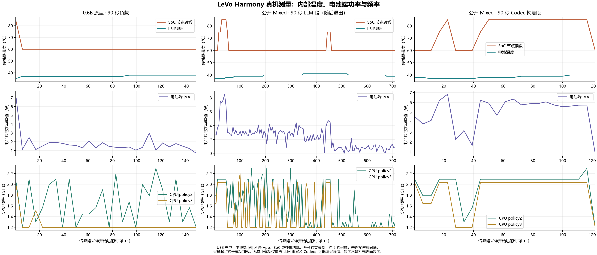

# LeVo Harmony：90秒大小模型、量化、ROM、RTF与功率温度

2026-11-02，签名LeVo Harmony v0.1.11、同一台手机。用户在120秒试验后改为90秒，固定2250个新音乐code、DiT每窗两步/CFG1.5、12个256帧窗口（重叠64、步进192），VAE输出48kHz双声道。推理后端均为CPU，未启用GPU/NPU。手机基础物理内存约11.13GiB；不要用“标称16GB”代替实际MemTotal。

## 结果状态

- 小模型完整生成2250个code并完成90秒有限值PCM，单次端到端194.710秒、RTF2.163。音乐头和小DiT未训练，输出写到`/dev/null`，这是部署/数值流程测试。
- 公开主Mixed LM生成齐2250个真实code，已记录加载到最后一码436.344秒；进入下一阶段前进程退出。正常退出API记录NORMAL/子码9、空消息，尚无明确OOM结论，不能称为稳定单次端到端。
- 用保存的这2250个code在新进程恢复Codec，**没有重复、填充或补造code**。12窗解码123.911秒，生成真实90秒WAV。LM计算段加Codec段为560.255秒、计算RTF6.225；排除了失败清理、退出重启、传输/重编译等恢复间隔，以及LM计时前少量条件准备。**6.225不是一次完整运行的端到端RTF。**

Mixed表示主分支直接输出人声与伴奏的混合歌曲token。这里的公开LM约3.1B，省略了官方另一个track LM，不能称为完整双LM约4B方案。小模型则是裁剪26层的Qwen3-0.6B文本骨干加未训练音乐适配器。

## 源模型参数和ROM

|模块|公开主Mixed|小模型原型|量化存储目标|
|---|---:|---:|---|
|LLM导出体参数|3,106,035,712|598,178,304|主体W4/group64，输出头W8，输入embedding BF16|
|LLM外部权重ROM|1573.71MiB|236.79MiB|同上|
|DiT源模型参数|751,534,224|195,416,128|W8/group64|
|DiT外部权重ROM|688.76MiB|211.41MiB|同上|
|VAE解码器源参数|84,414,082|共用同一权重|W8|
|VAE外部权重ROM|80.65MiB|80.65MiB|同上|
|上述`.weight`文件合计|2.288GiB|0.516GiB|不含图、embedding、条件表、KV、激活和packing|

公开DiT前述“约700M”只是论文量级描述，当前Mixed构造器与检查点形状严格匹配的精确计数是751.534M；它是39层、hidden1200、FFN4800。小DiT为22层、hidden1024、FFN2048。固定窗口导出会进行常量折叠/无用部分裁剪，因此源模型参数数量不能简单乘位宽来得到外部权重文件大小。LLM参数按已导出HF状态统计，不包括单列文本/风格条件表。

公开基包19个文件约3.64GiB；小模型设备上student/dit/vae/aux四目录磁盘占用合计886432KiB，约0.845GiB，包含embedding、tokenizer、图和少量运行配置。两者不是同一文件清单；ROM大小不能当成运行内存峰值。

## 当前执行recipe

|项目|公开主Mixed|小模型原型|
|---|---|---|
|LLM|CPU High / 4线程，953位置前缀|CPU Low / 4线程，514位置前缀|
|LLM采样|CFG1，seed2307，topK50，temperature0.9，最近50码惩罚1.1；测速抑制EOS|相同|
|DiT|CPU High / 6线程，两步Euler，CFG1.5，W8/group64|相同执行策略、不同模型权重|
|VAE|CPU Low / 6线程，W8，建图期间启用NEON Sin|同一模型和策略|
|会话|Memory Low / Power High；原计划LM释放后复用唯一DiT+VAE，公开模型本轮通过分进程恢复完成Codec|单进程串行，LM生成完释放，再复用Codec|

没有请求静态A4或KV4，也未审计每个KV缓冲的实际存储类型，不能称为W4A4KV4。Codec Session沿用`CPU_ENABLE_KLEIDIAI=0`的原入口；这不是“已开启全部最快kernel”的证明。静态MNN库SHA256为`fbaa87b8cae9cd451560803ee3837886fe7e44d48976fc12654654412226159c`。

## 90秒阶段速度

每行RTF＝该行秒数/90。prefill、decode是LLM的子项，不重复相加。

|阶段|公开模型秒数|公开模型阶段RTF|小模型秒数|小模型阶段RTF|
|---|---:|---:|---:|---:|
|LLM已记录段/小模型完整段|436.344|4.848|48.113|0.535|
|其中prefill|24.855|0.276|1.844|0.020|
|其中decode|未保留最终精确合计|—|44.983|0.500|
|DiT 12窗，共24步|66.053|0.734|49.166|0.546|
|VAE 12窗|56.317|0.626|95.989|1.067|
|Codec其余/小模型其余|1.541|0.017|1.441|0.016|
|计算段合计|560.255|6.225（恢复段相加）|194.710|2.163（单次端到端）|
|单次稳定端到端|未通过|暂无实测|通过|2.163|

公开恢复WAV已检查：17,280,044字节，48kHz、双声道、PCM16、4,320,000帧＝90秒。没有完成播放器或原精度/量化听感A/B验收。

## 内存与“显存”

|指标|公开模型90秒|小模型90秒|
|---|---:|---:|
|已捕获进程RSS峰值|至少5556.32MiB＝5.43GiB（退出前检查点；完整峰值未知）|1214.61MiB＝1.19GiB|
|公开Codec恢复段RSS峰值|1632.33MiB|已包含在全链峰值中|
|完整PSS峰值|LLM退出前未持久化；不能用退出瞬间PSS代替|1152.65MiB|
|最低系统可用内存|已记录1060MiB|3697MiB|
|图形内存API峰值|恢复Codec读数0KiB，LLM完整峰值未保留|0KiB|

RSS为共享物理内存中的进程驻留量，不是独立显存。HiDebug PSS按Pss+SwapPss口径；图形API0不等于整机GPU使用为零。RSS20ms独立采样，PSS/图形API在另一线程中查询，查询后等待500ms；跨阶段慢查询只进全局峰值。采样可能扰动性能或漏掉更短峰值。公开与小模型处于不同热状态、输入和会话上下文，不能当作严格同条件模型尺寸消融。

## 为什么比旧30秒慢

小模型旧30秒RTF1.472，本轮90秒2.163：LLM0.510→0.535、DiT0.289→0.546、VAE0.634→1.067。VAE占总RTF增量约63%，DiT约37%，其余项抵消一小部分。VAE/DiT窗口形状、权重位宽、步数未改变；LM的长KV不能解释固定窗口Codec的回退。

恢复Codec在新进程中运行，小模型Codec则接在LM之后；两者CPU线程池状态、实际核调度、温度和输入都没有锁定。功率/频率记录存在差异，但目前没有证明哪个kernel退化或哪项是唯一根因。下一轮应先对同一个固定latent比较“独立VAE”和“运行LM后VAE”，同步记录实际工作核、亲和性与线程池，避免继续用不同输入/热状态成绩归因量化。

## 温度与功率图

[SVG](../reports/levo-90s-power-thermal.svg) · [PDF](../reports/levo-90s-power-thermal.pdf)

三列分别为小模型采样（从LM末尾约46秒才开始）、公开LM段（退出前）、公开Codec恢复段。横轴各自独立；灰区是2250码生成齐后释放/等待直至退出，未计入6.225计算段合计。约5秒采样，不能当作全程瞬时峰值；没有连接或补造恢复间隔。

USB供电/充电全程存在。功率由电池电压×电流的绝对值估算，仅代表电池端交换功率幅值，不是App、SoC或整机功耗。供应商`sys_power_now`单位未验证，只保留原值，没有直接换算成W。电池电压µV、电流mA、温度0.1°C的单位依据[OpenHarmony BatteryInfo文档](https://github.com/openharmony/docs/blob/master/en/application-dev/reference/apis-basic-services-kit/js-apis-battery-info.md)；SoC节点按[thermal sysfs接口](https://docs.kernel.org/driver-api/thermal/sysfs-api.html)解读。内部传感器不是机壳表面温度，也不是热像图。

## 保留的120秒与失败试验

见[120秒记录](CHAIN_COMPARISON_120S.md)。公开High多次在2450或2725码检查点后退出，Low在加载时触发Arm82零尺寸缓冲断言。前台检查已补齐，单纯保持屏幕亮着不足以验证前台性能。不要把不完整LM时间与独立Codec相加冒充120秒端到端RTF。

统一数据为`reports/levo-test-report.json`中`serial_chain_comparison_90s_2026_11_02`。每轮保留签名HAP哈希、配置、前台轮询、原始传感器样本和恢复来源。音频、模型、签名、原始崩溃日志留本机，不上传GitHub。新加的析构前检查点/阶段标记用于后续定位退出位置，没有宣称已经修复退出问题。
