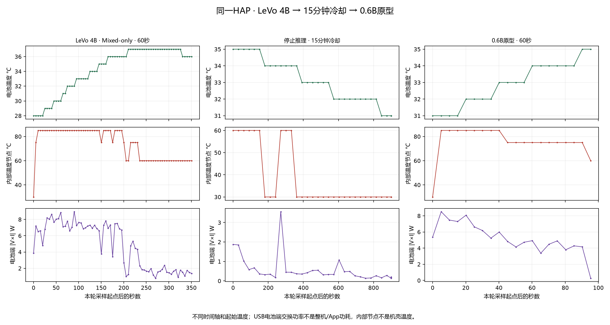

# 大小模型60秒、间隔15分钟测试

2026-11-03用户指定：先测公开模型，等冷却15分钟，再测小模型；两边各输出60秒。原30/90/120秒入口及历史模型保留。

汇总名称统一为 **LeVo 4B（Mixed-only实测链路）**。本次LM 3.106B＋DiT 0.752B＋VAE 0.084B，三模块约3.942B，另有条件表；“4B”不是单独LM的精确参数量。本次没有运行官方track LM。

## 配方

- LeVo Harmony v0.1.14，同一HAP、原始研究目录，未替换产品歌曲模型。
- 公开主Mixed LM：主体W4/g64、头W8、输入表BF16，CPU High/4线程；小模型主体相同目标位宽，CPU Low/4线程。
- 两种DiT分别751.534M与195.416M，均W8/g64、CPU High请求6线程、两步Euler、CFG1.5。
- 两边沿用同一个旧W8预训练VAE，CPU Low请求6线程、NEON正弦；不是重新导出的产品VAE。
- 1500个新音乐code、25Hz、8个256帧窗，重叠64、步进192；去重输出60秒、48kHz、双声道PCM16。
- 60秒测速抑制EOS，保证等长；不能用它评估模型自然结束位置。公开模型为训练权重歌曲，小模型音乐头与DiT未训练，WAV仅供数值流程试听。

| 部分 | LeVo 4B（Mixed-only） | 0.6B研究原型 | 当前量化／存储方案 |
|---|---:|---:|---|
| 自回归LM | 3,106,035,712参数 | 598,178,304参数 | 主体W4，group size 64；公开CPU High/4线程，小模型CPU Low/4线程 |
| LM音乐输出头 | 已计入LM参数 | 已计入LM参数 | W8；输出16384个音乐code＋EOS，共16385类 |
| LM输入embedding／歌词风格条件表 | 训练表 | 含未训练音乐适配部分 | BF16；不随LM主体压成W4 |
| DiT | 751,534,224参数 | 195,416,128参数 | W8，group size 64；CPU High请求6线程，两步Euler、CFG1.5 |
| VAE | 84,414,082参数 | 相同源权重和旧W8产物 | W8；CPU Low请求6线程、NEON正弦；本轮未重新逐层核验旧产物分组大小 |
| Codec码本、投影、mask、均值／标准差 | 相同接口 | 相同接口 | FP32辅助表，不额外压为W4/W8 |
| 激活 | 由MNN后端及精度偏好决定 | 相同原则 | 未请求静态A4，不标成W4A4 |
| KV cache | 本首增量decode缓存 | 本首增量decode缓存 | 默认运行时缓存，未请求KV4；未逐缓冲审计实际存储位宽 |

W4/W8表示权重存储量化目标，不代表所有算子都执行INT4/INT8。CPU High/Low是计算精度偏好，不是位宽量化配方。当前两条产品／测试主线都是CPU，没有在本轮切到GPU/NPU，也没有启用已经失败的A4/KV4实验。

## 执行

先手动解锁手机并打开LeVo Harmony保持前台。PowerShell 7运行：

```powershell
pwsh -NoProfile -File tools/run_cooled_pair.ps1 -Device YOUR_DEVICE_ID -RunId cooled60-20261103-r2 -DurationSeconds 60 -CoolingMinutes 15 -Python C:\path\to\python.exe
```

脚本先运行公开模型、保存完整报告与WAV，再停止该App并开始15分钟冷却计时。冷却期间每30秒采样电池温度、内部温度节点、电压电流；不修改亮屏设置或自动唤醒手机。推理中每5秒采样，RSS名义间隔20ms，PSS/图形内存也保留。

15分钟后如App不在前台，检查点为`awaiting-awake`。手动解锁并打开LeVo Harmony后，使用**同一个RunId**加`-Resume`继续，只跑小模型，不重跑公开模型：

```powershell
pwsh -NoProfile -File tools/run_cooled_pair.ps1 -Device YOUR_DEVICE_ID -RunId cooled60-20261103-r2 -Resume -Python C:\path\to\python.exe
```

WAV和中间原始数据留本机。配对JSON内包含两边完整阶段和温度报告，最终发布仍追加到唯一`reports/levo-test-report.json`。固定等待15分钟不保证两轮起始温度相同，因此保留两轮实际起始温度、冷却曲线、前台/息屏记录；USB下电池端交换功率不是App或整机功耗。

## 验证状态

v0.1.14已构建、签名并安装；37项Python回归通过。首次r1在后台启动，被主动停止，未完成模型加载／生成，不纳入性能成绩。r2前台检查未通过，未启动推理。r3两边完整60秒均通过，两个阶段的foregroundStable/displayStable全部为true。

公开推理完成后的首次音频导出被主机路径白名单拒绝，原因是native返回`/data/storage/el2/base/…`目录别名。已映射到该App的物理私有路径，取回原WAV后继续冷却，**没有重跑公开推理**。原错误和恢复动作保留在报告中。

## 60秒实测结果

2026-11-03：两轮各1500码、8个窗口，固定时长抑制EOS。实际连续冷却900.304秒（09:27:47至09:42:47，中国时间），09:42:48开始小模型；冷却期间未计划任何模型推理，34次温度／电压电流观测。公开输出成功至冷却开始之间还包含文件导出修复，实际两轮间隔超过15分钟。

| 指标 | LeVo 4B（Mixed-only） | 0.6B原型 |
|---|---:|---:|
| LM，含加载／释放 | 204.352秒 | 32.946秒 |
| 其中prefill | 20.976秒 | 1.815秒 |
| 其中decode | 176.739秒 | 30.045秒 |
| decode吞吐 | 8.481 token/s | 49.891 token/s |
| DiT，8窗×2步／CFG1.5 | 81.493秒 | 19.245秒 |
| VAE，8窗 | 61.135秒 | 41.721秒 |
| 其他 | 4.838秒 | 1.148秒 |
| 总生成耗时 | 351.818秒 | 95.060秒 |
| 整链RTF | **5.864** | **1.584** |
| LLM／DiT／VAE阶段RTF | 3.406／1.358／1.019 | 0.549／0.321／0.695 |
| RSS峰值 | 4756.48MiB，4.645GiB | 1184.83MiB，1.157GiB |
| HiDebug PSS峰值（含SwapPss口径） | 4.789GiB | 1.100GiB |
| 图形内存API峰值 | 0KiB | 0KiB |
| 电池温度，起点→峰值→末样本 | 28→37→36°C | 31→35→35°C |
| 电池端交换功率幅值范围 | 0.785–8.950W | 0.274–8.510W |
| 电池端交换功率样本算术均值 | 4.836W | 5.232W |
| 推理温度采样数／间隔中位数 | 71／5.007秒 | 20／5.014秒 |

prefill和decode是LM子项，不能重复相加。RSS/PSS不是专用显存，图形API的0也不代表整机GPU完全没有使用。两边默认CPU路径、无静态A4／KV4。小模型本轮仍需再少5.06秒才能达到60秒RTF1.5；VAE约占其总时间43.9%，目前没有通过此次时长测试就获得新kernel优化的结论。

两轮起始电池温度不同；冷却期间从35降至31°C，没有恢复到公开模型初始28°C，故不能称为起始热状态相同的受控模型消融。内部温度节点仍是30/60/75/85°C等较粗读数，不是机壳温度。USB连接存在，电池端交换功率不是App、SoC或整机功耗；不能用5.232W与4.836W直接判断两模型能效。



[SVG](../reports/cooled-pair-cooled60-20261103-r3.svg) · [PDF](../reports/cooled-pair-cooled60-20261103-r3.pdf)

## 两份输出

均已从手机取回并核验：2,880,000帧、48kHz双声道、PCM16，文件各11,520,044字节，实际60秒。公开PCM RMS0.27349，小模型0.10598；检查通过仅说明结构、时长、非静音，不是音质或播放器验收。

- 公开歌曲：本机`reports/local/cooled-pair/cooled60-20261103-r3/public-60.wav`，SHA256 `915d482c1db0c95516d12c022095c0c78cd50bd071d7bf537b0151bdc18126e1`。
- 小模型数值音频：本机同目录`student-diagnostic-60.wav`，SHA256 `b351b1c93b5949dd2e037b28005ab8f5f5e2eb810725cd24d5211a1dfea25141`。音乐头、小DiT未训练，不称为已经训练好的歌曲。

HAP SHA256为`59cd99a6d9b44c855caace630ab7a7dd183b5f33a72e869f2fe7a6bbc9a08f89`；权重沿用原研究目录，本轮没有重新全量哈希手机上的全部权重，不将历史部署哈希当作本轮重新校验。配对数据与原始逐样本观测已合并进唯一报告`cooled_60s_comparison_2026_11_03`，旧43个区块保持原值。音频、模型权重与签名材料不上传GitHub。
