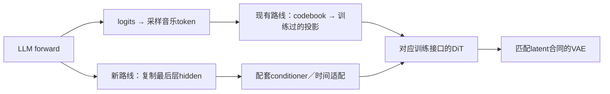

# LLM逐token hidden → Diffusion：适配工具与接口

2026-11-03。用户确认输入为每个生成token对应的最后层hidden序列`[B,T,H]`，并指出prefill最后位置的hidden用于第一个生成token。下文采用这种 **predictor对齐**；末层归一化前／后仍须以训练实现核对。

**可以适配，MNN已有hidden输出接口；还需要配套训练过的conditioner与DiT输入适配。当前App仍走已验证的token/codebook路线，本轮没有接入私有权重或测出新的RTF。**

## 两条链路的区别



本仓库`MixedLm.hpp`目前返回logits并采样音乐码。`MixedCodec.hpp`用16384×32的codebook和1024×32投影权重得到DiT的1024维条件；公开DiT输入是`[2,256,1200]`，包含mask、上下文、条件和噪声latent。**1024维条件不是原始LM hidden。**

有两种可行接法：已有hidden-conditioned DiT时，复用其训练时的conditioner；想复用当前token-conditioned DiT时，需要训练并验证通向原条件空间的桥接器。只新增随机Linear、截断／补零到相同宽度，不能获得已训练的音乐语义。predictor hidden不能唯一决定随机采样出来的code；若桥接目标是该code的embedding，训练接口应考虑采样code或其他对应表示。

Qwen与Llama即使H相同，hidden坐标和分布也不同。换骨干须使用匹配的conditioner，或重新训练／蒸馏。VAE复用取决于latent Codec、通道、缩放、采样率和时间步长。

## prefill最后hidden就是第一项

设前缀有P个位置，生成`z₀…zₜ`。采用用户描述的predictor定义：

| 计算 | 最后hidden | 预测／采样 | 保存为条件 |
|---|---|---|---|
| 一次prefill整个歌词／风格前缀 | 前缀位置P−1的h₀ | z₀ | h₀ |
| decode输入z₀ | 位置P的h₁ | z₁ | h₁ |
| decode输入z₁ | 位置P+1的h₂ | z₂ | h₂ |

T个生成token的条件来自绝对位置`P−1 … P+T−2`，包括prefill最后位置，排除更早的歌词／风格位置。通常T个token需要一次prefill加T−1次增量forward；EOS不计音频帧。不能漏掉h₀后从h₁开始，也不能为读hidden再forward一次。

另一种训练定义是consumed-token：条件来自读入zₜ后的hidden，位置为`P … P+T−1`，最后一个采样token也必须送入模型。检查工具同时支持两个定义，**已经训练好的模型不能在部署时随意切换定义**。两种定义的增量KV计算均有CPU对齐测试，彼此的序列不同。

## 所需工具

| 环节 | 工具／已有接口 | 适配内容 |
|---|---|---|
| 原始权重参考 | PyTorch、Transformers、strict checkpoint加载 | 固定token，确定最后层和final norm位置 |
| LLM导出 | MNN 3.6.1官方`llmexport.py` | 保留`logits`与`hidden_states`，检查实际I/O |
| hidden读取 | MNN C++ `getOutputIndex`、`getOutputs` | 同一次forward后复制有效位置；不二次forward |
| 条件转换 | 已训练conditioner的Torch/PT→ONNX→MNN | 严格加载；直接用H时也需训练合同支持identity |
| 时间转换 | 配套length regulator／temporal adapter／cross-attention | token与latent频率不同时按训练实现处理 |
| DiT导出 | 与hidden匹配的DiT wrapper，ONNX/MNN | condition、mask、CFG空条件、latent和步数 |
| 部署包 | 版本化合同和新runtime adapter | LM／conditioner／DiT／Codec身份，独立modelId |
| 验证 | 固定token teacher forcing、量化误差、分块／真机采样 | hidden、latent／PCM误差、听感与RTF分开 |

目前`modelctl`部署模块为llm/dit/vae，App合同是token/codebook条件。新增研究JSON**不是可直接导入App的model-bundle**。真正接入要增加conditioner组件和hidden条件runtime；新接口需重新构建签名App一次，之后同合同换权重才可复用。

## MNN可以复用的部分

固定版本MNN 3.6.1默认导出两项输出；本轮检查已有公开LM和小模型的MNN图，也都发现`logits`、`hidden_states`。默认非MTP路径返回经过final norm并按`logits_index`选取的hidden；`-1`通常只取最后位置。需要全位置时须核对切片和运行时索引。EAGLE／DFlash可能把hidden输出改成多层特征拼接，不能直接代替末层hidden。[MNN导出实现](https://github.com/alibaba/MNN/blob/3.6.1/transformers/llm/export/utils/model.py)、[输出名称定义](https://github.com/alibaba/MNN/blob/3.6.1/transformers/llm/export/llmexport.py)。

引擎须在load前启用`hidden_states`；forward返回logits，隐藏输出通过公开API读取。下一次forward会替换输出，应及时复制为自有缓冲。[MNN引擎实现](https://github.com/alibaba/MNN/blob/3.6.1/transformers/llm/engine/src/llm.cpp)、[C++头文件](https://github.com/alibaba/MNN/blob/3.6.1/transformers/llm/engine/include/llm/llm.hpp)。

可选helper为`runtime/include/levo/experimental/HiddenStateTap.hpp`，示意调用：

```cpp
// model已创建、尚未load；原有目录／配置沿用该模型加载器。
if (!model.set_config(R"({"hidden_states":true})")) throw std::runtime_error("config failed");
if (!model.load()) throw std::runtime_error("load failed");
auto logits = model.forward(prefixIds, true);
auto h0 = LevoHiddenResearch::copySingleStep(model, trainedHiddenWidth);
// 用同次forward的logits采样z0，将h0加入条件序列。
// 下次forward({z0}, false)后复制h1，用于下一token；不再prefill。
```

helper只接受canonical `[1,1,H]` FP32图输出并检查有限值；全位置／带padding／分块prefill输出须另写有效位置选择器。它不改变内部计算精度，不采样、不管理KV，也不自动完成conditioner。已过鸿蒙ARM64头文件语法检查，尚未在App中链接运行。图输出名不构成私有权重数值兼容证明。

PyTorch参考可直接读取骨干`last_hidden_state`并核对该模型是否已final norm，不必保留所有层的hidden。参考[Transformers Qwen3接口](https://huggingface.co/docs/transformers/en/model_doc/qwen3)。

## 分块、内存与量化

以下仅为算术示例：H=2560、条件宽1024、25token/s、窗口256、重叠64；**不代表尚未提供配置的私有Qwen 3B**。window=10.24秒，hop=7.68秒；60秒1500帧需8窗，重叠帧不重复计音频长度。

| 缓冲 | FP32 | FP16 |
|---|---:|---:|
| 256帧hidden | 2.50 MiB | 1.25 MiB |
| 256帧1024维condition | 1.00 MiB | 0.50 MiB |
| 60秒完整hidden | 14.65 MiB | 7.32 MiB |
| 120秒完整hidden | 29.30 MiB | 14.65 MiB |
| 300秒完整hidden | 73.24 MiB | 36.62 MiB |

不包含KV、权重、packing、DiT/VAE激活和分配器，真实峰值仍需测量。可先生成完整hidden、销毁LM，再分窗解码以验证数值和降低共驻压力。边decode边出声则须保留LM+KV、上下文与有界队列并做背压。hidden有界缓冲**不等于KV有界**；不能每chunk重新prefill丢掉训练需要的历史来冒充等价流式。

量化先保留conditioner FP32/FP16参考，再测LM W4。原token路线logits接近或top1一致，不证明hidden条件接近。用同一token轨迹比较hidden相对L2、余弦、逐通道尺度，再比较DiT和PCM，最后听测。不同随机采样轨迹不宜直接拿hidden L2判质量。AWQ／旋转须保持hidden边界与投影坐标一致；W4文件不能证明A4/KV4已生效。CFG须遵循训练时空条件／mask，不能随意用零向量。

## 可运行检查与本轮结果

从仓库根目录运行（全测试还需requirements.txt）：

```powershell
python tools/inspect_hidden_conditioning.py --contract configs/conditioning/hidden-sequence.example.json --seconds 60
python tools/inspect_hidden_conditioning.py --contract configs/conditioning/hidden-sequence.example.json --seconds 300
python -m unittest discover -s tests -v
```

支持`--lm-config`核对H，`--mnn-json`核对转换器输出的`outputName`；`--out`保存新结果且拒绝覆盖。输出明确`currentAppCompatible=false`、`trainingQualityVerified=false`。等频一对一以外的时间适配被拒绝，须先实现训练定义。

46项CPU测试通过，其中9项新增：小型随机Qwen3的增量KV与整段teacher-forcing hidden对齐、两种token位置、窗口边界、宽度／频率拒绝及内存算术。鸿蒙ARM64 helper语法检查通过；两个真实LM图的输出名及配置宽度检查通过。**没有执行私有LM／conditioner／DiT，没有新手机RTF或歌曲质量结论。** 摘要写入唯一`reports/levo-test-report.json`；完整图元数据只留本地。

## 下一位Agent接入顺序

1. 取得私有LM config及权重、确切norm取点、predictor定义、音乐tokenizer／速率／EOS策略、训练forward。禁止猜Qwen 3B的H。
2. 取得匹配conditioner和DiT权重／config、参考I/O、mask及CFG空条件。直接用hidden时也须核对cross-attention和时间长度；没有适配权重就先训练，不随机补参数。
3. PyTorch固定token比较整段与增量，包含prefill第一项、EOS、chunk跨界、尾段。strict恢复checkpoint，不能用strict=False掩盖缺项。
4. 导出LM双输出，做MNN FP32同轨迹hidden对照；再导出conditioner和hidden-input DiT，分别Torch→ONNX→MNN校验。训练用pre-norm时必须修改取点，不能直接用默认post-norm。
5. 准备至少20条多风格／多长度／歌词和器乐校准轨迹，另留验证集。评估W4的hidden及下游音频误差，按敏感性决定局部保留精度，不能直接套旧配方。
6. 新增hidden合同的bundle和runtime，保留原版本与入口。先单窗10.24秒，再5窗／60秒。记录真实长度、首次／预热、阶段／整链RTF、RSS/PSS、KV、前台和温度；旧token链路RTF不可沿用。

最小适配包：**LM权重＋config、配套conditioner权重、DiT权重＋forward、Codec/VAE身份、固定token对应的参考hidden／condition／latent样本**。权重可闭源；公开仓库只放接口、工具和脱敏结果。
