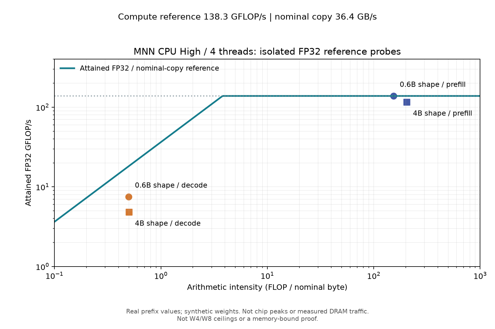

# LLM算子真机基准（2026-11-24）

设备CMM-AL00／ARM64；MNN固定fork，CPU High、4线程、Memory Low，未绑核。独立App v0.1.0。
主体W4/group64、头W8；0.6B dynamicOption=2，4B=0。后端coreBytes4不证明每个量化乘法均为FP32。
每轮513位置真实prefix＋64次teacher-code decode，KV513→577；首次单列，预热为后两轮均值。全程亮屏、App前台。

| 模型 | 首次Prefill ms | 预热Prefill ms | 纯Decode ms/token | token/s | RSS峰值 MiB | 模型ROM MiB | 起止电池温度 °C |
|---|---:|---:|---:|---:|---:|---:|---|
| 0.6B | 2153.72 | 2166.35 | 18.35 | 54.51 | 608.93 | 572.82 | 29.0→29.0 |
| 4B | 13466.59 | 14068.02 | 100.61 | 9.94 | 2598.88 | 2077.29 | 30.0→33.0 |

ROM仅计LM图、权重、词表、embedding和配置，不含App／运行库／其他模块。RSS不是专用显存。
这是短上下文固定工作量，不是长上下文吞吐、音乐RTF或音质验收。重复logits／4B hidden误差均为0。

## 各算子图内基准

独立诊断为1次prefill＋2次decode；下表按单次forward归一化。回调可能嵌套，不能当独立kernel延迟或相加替代端到端。
完整1592条逐节点记录（0.6B 700条、4B 892条）在统一JSON报告的perNodeCallbackBaselines中。

### 0.6B

| 阶段 | 算子类型 | 调用次数 | 每次调用均值 ms | 每次forward合计 ms |
|---|---|---:|---:|---:|
| decode | Convolution | 394 | 0.0573 | 11.2970 |
| decode | Attention | 56 | 0.1924 | 5.3871 |
| decode | RoPE | 56 | 0.0078 | 0.2178 |
| decode | BinaryOp | 60 | 0.0045 | 0.1347 |
| decode | LayerNorm | 114 | 0.0020 | 0.1131 |
| decode | UnaryOp | 4 | 0.0038 | 0.0075 |
| decode | Raster | 12 | 0.0011 | 0.0067 |
| decode | Cast | 2 | 0.0005 | 0.0005 |
| prefill | Convolution | 197 | 7.6150 | 1500.1534 |
| prefill | Attention | 28 | 21.2499 | 594.9983 |
| prefill | LayerNorm | 57 | 0.8593 | 48.9778 |
| prefill | RoPE | 28 | 0.9329 | 26.1208 |
| prefill | BinaryOp | 30 | 0.8371 | 25.1116 |
| prefill | Raster | 8 | 0.2488 | 1.9905 |
| prefill | UnaryOp | 2 | 0.0720 | 0.1441 |
| prefill | Cast | 1 | 0.0013 | 0.0013 |

### 4B

| 阶段 | 算子类型 | 调用次数 | 每次调用均值 ms | 每次forward合计 ms |
|---|---|---:|---:|---:|
| decode | Convolution | 506 | 0.3018 | 76.3538 |
| decode | Attention | 72 | 0.3316 | 11.9383 |
| decode | RoPE | 72 | 0.0143 | 0.5163 |
| decode | BinaryOp | 76 | 0.0088 | 0.3333 |
| decode | LayerNorm | 146 | 0.0034 | 0.2485 |
| decode | Raster | 12 | 0.0122 | 0.0732 |
| decode | UnaryOp | 4 | 0.0077 | 0.0153 |
| decode | Cast | 2 | 0.0005 | 0.0005 |
| prefill | Convolution | 253 | 46.8784 | 11860.2359 |
| prefill | Attention | 36 | 39.1528 | 1409.5019 |
| prefill | LayerNorm | 73 | 2.5818 | 188.4692 |
| prefill | BinaryOp | 38 | 4.5934 | 174.5492 |
| prefill | RoPE | 36 | 2.9307 | 105.5050 |
| prefill | Raster | 8 | 0.5603 | 4.4820 |
| prefill | UnaryOp | 2 | 0.0679 | 0.1358 |
| prefill | Cast | 1 | 0.0011 | 0.0011 |

## 独立算子参考

CPU High／4线程，同模型形状。激活使用真实prefix值，但不是抓取的中间激活分布；MatMul为合成FP32权重、RMSNorm为单位gamma，与真实量化LM算子分开。
先执行3次（首次单列、再预热2次），取随后5次中位数；timing为重新执行＋同步，不含输入复制／检查。非MatMul全量公式校验，MatMul仅4或8个元素double参考校验。

| 形状模型 | 阶段 | 算子 | 输入宽度 | 首次 ms | 预热中位 ms | 相对L2 |
|---|---|---|---:|---:|---:|---:|
| small | decode | MatMul | 1024 | 5.9809 | 0.8378 | 1.01e-06 |
| small | decode | RMSNorm | 1024 | 0.1734 | 0.0158 | 2.59e-08 |
| small | decode | SiLU | 1024 | 0.3352 | 0.0731 | 2.05e-07 |
| small | decode | ResidualAdd | 1024 | 0.1416 | 0.0230 | 0 |
| small | decode | GateMultiply | 3072 | 0.1289 | 0.0213 | 0 |
| small | prefill | MatMul | 1024 | 47.3772 | 23.3356 | 7e-07 |
| small | prefill | RMSNorm | 1024 | 0.3422 | 0.0911 | 8.07e-08 |
| small | prefill | SiLU | 1024 | 1.2216 | 0.5458 | 2.93e-06 |
| small | prefill | ResidualAdd | 1024 | 0.3133 | 0.3000 | 0 |
| small | prefill | GateMultiply | 3072 | 0.9034 | 0.8770 | 0 |
| large | decode | MatMul | 2560 | 15.6628 | 10.2945 | 5.97e-07 |
| large | decode | RMSNorm | 2560 | 0.3620 | 0.0142 | 1.38e-07 |
| large | decode | SiLU | 2560 | 0.1478 | 0.0631 | 1.06e-05 |
| large | decode | ResidualAdd | 2560 | 0.0877 | 0.0170 | 0 |
| large | decode | GateMultiply | 9728 | 0.1027 | 0.0119 | 0 |
| large | prefill | MatMul | 2560 | 242.3833 | 219.3992 | 9.03e-07 |
| large | prefill | RMSNorm | 2560 | 0.9053 | 0.2852 | 9.01e-08 |
| large | prefill | SiLU | 2560 | 2.0720 | 1.2766 | 7.68e-06 |
| large | prefill | ResidualAdd | 2560 | 0.7553 | 0.3370 | 0 |
| large | prefill | GateMultiply | 9728 | 2.2620 | 1.4909 | 0 |

## Roofline与两阶段

当前FP32实测参考138.31 GFLOP/s；128MiB双数组复制的名义读写带宽36.40 GB/s。

这不是芯片峰值或实测DRAM；不据此判定W4／W8 LLM已经Memory Bound。公式、对偶符号、可行性阶段与整数阶段见[理论说明](LLM_OPERATOR_THEORY.md)。

原样重新编译→正确性→设备→完整固定LLM工作量链已通过，误差0；它验证自动化链路，不是新kernel加速。
下一阶段需开发真实低比特／融合候选，统一数值门槛与开发预算，再比较Frozen Dual、动态CG和Greedy。Korch／MoKA原版未移植。

## 复现与协作

使用[工具指南](LLM_OPERATOR_LAB.md)采集数据，`tools/summarize_llm_operator_lab.py`汇总逐节点、LLM和独立校准为一个JSON。
`tools/plot_llm_operator_roofline.py`读取汇总JSON输出图；`tools/review_llm_operator_hotspots.py`可委派显式算子汇总给本机claude.cmd。
本轮只读热点任务实际路由deepseek-v4.1-flash并返回。后续文件任务、GLM理论任务和代码提案任务超时未交付，已终止，不归功为已生成实现，用量未知。
协作器默认禁用工具／MCP／自动发现，保留用户配置的模型路由；超时停止本次进程树。重要理论与代码也可委派，但必须收到成果、复核并通过测试才集成。
