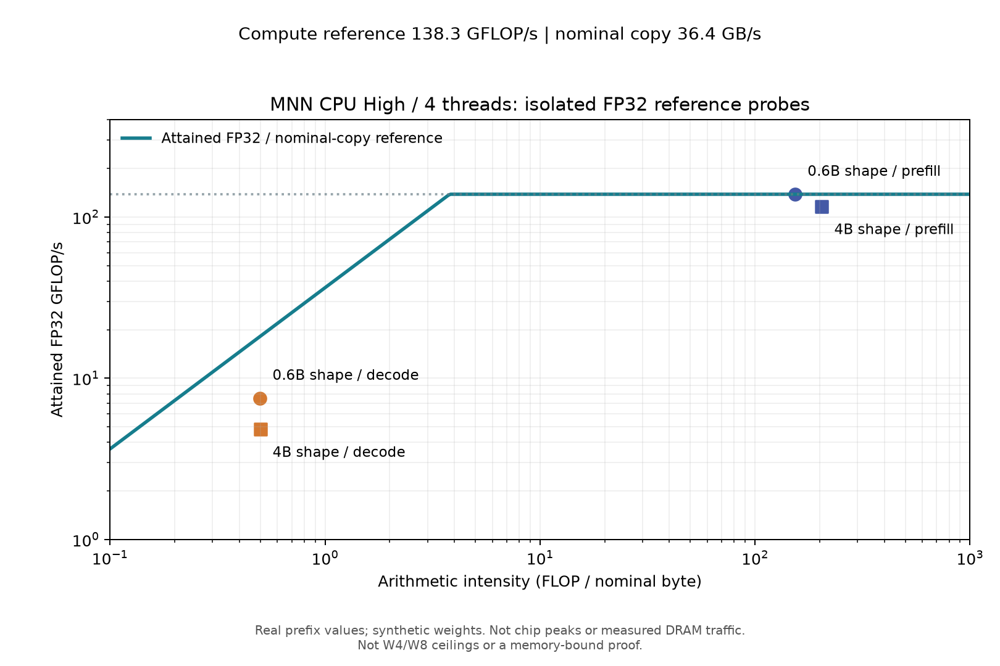

# 有限候选库的两阶段求解与Roofline

共享实现只开发一次、按位置执行多次的新模型及链接对偶，见[频率感知与开发预算](FREQUENCY_AWARE_COLUMN_GENERATION.md)。下文区间池仍保留为原有对照。

## 适用范围

代码处理固定串行顺序的连续区间候选，不是任意DAG的Korch移植。
每个候选必须已经满足依赖、外部输入输出及数值约束；区间覆盖本身不能证明融合语义合法。

令候选k覆盖primitive集合S_k，延迟c_k，逻辑流量d_k；工作区s_k超预算的候选先剔除。
主问题为：

\[
\min_x\sum_k c_kx_k,\quad
\sum_{k:i\in S_k}x_k=1,\quad
\sum_k d_kx_k\le D,\quad x_k\ge0.
\]

LP对偶中覆盖价格π_i自由，流量价格θ≤0：

\[
\max\sum_i\pi_i+D\theta,\qquad
\sum_{i\in S_k}\pi_i+d_k\theta\le c_k.
\]

因此reduced cost是`c_k - Σπ_i - θ*d_k`。因为θ非正，资源稀缺会增加耗流量候选的reduced cost。
`solver.py`直接使用CPLEX返回的非正θ，不能再错误翻转符号。

## LP／Pricing后再做整数选择

1. 对已有列解LP；使用对偶与已知或预测成本选择下一列。
2. 新列经过编译、数值与设备测试，合格后加入主问题并更新对偶。
3. 最后将真实列的变量限制为0／1，求可部署的完整覆盖。

这里还必须区分可行性阶段。覆盖等式加入非负人工列a_i后，先**只最小化Σa_i**。
若人工质量仍为正，真实列在这一阶段的目标系数为0；feasibility pricing必须用`0-Σπ_i-θ*d_k`。
人工质量达到数值容差内的0后，固定人工变量为0，再最小化真实延迟。这是明确的可行性→成本两阶段，不能用任意大惩罚替代。

已加入反例测试：单节点native延迟1、流量1000000；候选延迟1000、流量999999；预算999999。
`bigM=1+sum(costs)`会宁可保留约1e-6人工质量，误报真实LP不可行；真正两阶段会返回候选和延迟1000。
LP与整数解也不同：native成本1／流量10，候选成本0.5／流量20，预算15，LP为0.75、整数最优为1。

## 哪些保证成立

- 已测完整有限库、精确pricing、LP达到最优且未遗漏负reduced-cost列时，可以在求解器数值容差下报告该有限库的LP最优值／整数问题下界。
- 预测成本或Agent启发式pricing不能证明未见候选不存在改进，不能给全局最优证书。
- LP列生成结束后，对受限列解一次MIP，通常不能证明完整库整数最优；需要完整库Oracle或进一步整数定价／分支定价。
- 串行区间且没有累计资源约束时，最短路径／DP可直接求最优，因此必须纳入对照。
- scratch是单kernel最大工作集可行性，不是所有kernel的scratch相加，更不是可软件管理的CPU SRAM。
- 候选延迟之和不等于实际整模型延迟，最终仍需真实图集成复测。

## Roofline模型

`search.py`采用`max(FLOPs / attainedCompute, logicalBytes / nominalBandwidth)`作为启发式候选成本。
当前真机参考为MNN CPU High、4线程的FP32 MatMul和四工作线程复制；实际数值见统一报告及图。

它不是芯片理论峰值：逻辑字节缺少部分权重／KV／packing读写，复制没有硬件DRAM计数器，FP32校准也不适用于直接判定混合W4／W8内核上限。
图只绘制4个独立FP32 MatMul点，没有把量化图内回调点强放到FP32参考线上。
后续应按GEMM／GEMV、量化方式、packing、序列长度和线程分别校准，并结合真实kernel热点验证预测误差。
