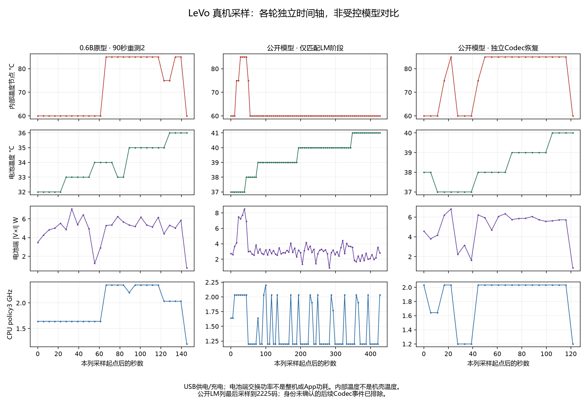

# 模型、速度、内存与温度采样总结

> 2026-11-03用户明确“间隔”指两轮间冷却：公开模型60秒 → 冷却15分钟 → 小模型60秒。推理中每5秒采样保留；见[新测试协议及实际状态](COOLED_60S_COMPARISON.md)。本页下方为2026-11-02历史总结，不代表新轮已完成。

2026-11-02。LeVo音乐v1.0.6、LeVo Harmony v0.1.13；本轮手机系统自报Mate90ProMax/Kirin9050，MemTotal约11.13GiB。ACE-Step、CosyVoice、原有模型和实验入口保留。

## 模型表

| 项目 | 0.6B研究原型 | 公开主Mixed模型 |
|---|---|---|
| LM参数 | 598,178,304（0.598B） | 3,106,035,712（3.106B） |
| LM结构 | Qwen3，26层，hidden1024，FFN3072 | Llama接口，36层，hidden2048，FFN11008 |
| LM量化／外部weight | 主体W4/g64、头W8、输入表BF16；236.79MiB | 相同目标位宽；1573.71MiB |
| DiT参数 | 195,416,128（195.416M） | 751,534,224（751.534M） |
| DiT结构 | 22层，hidden1024，FFN2048，16头 | 39层，hidden1200，FFN4800，30头 |
| DiT量化／外部weight | W8/g64；211.41MiB | W8/g64；688.76MiB |
| VAE参数 | 84,414,082（84.414M） | 同一预训练解码器架构和源权重 |
| 当前VAE量化／外部weight | 旧W8基线；80.65MiB | 本轮PT重导出W8/g64；81.88MiB |
| 上述三模块源参数合计 | 878,008,514（0.878B） | 3,941,984,018（3.942B） |
| 当前可部署包ROM | 18个资产，906,655,992字节，约0.844GiB | 20个资产，3,910,738,076字节，约3.642GiB |
| 训练状态 | 文本骨干预训练；音乐头／适配器和小DiT未训练 | 主LM、DiT、VAE已训练，可生成混合歌曲 |
| 当前模型包 | student-onnx-test-v1 | public-pt-vae-test-v1 |

参数合计不含另列的文本、风格条件表；外部weight不含图、embedding、tokenizer、条件表和运行配置。完整包ROM包含这些资产，仍不等于推理RAM。旧大小模型VAE外部weight相同；当前公开替换包重新量化，文件和SHA已不同。这里是主Mixed LM，省略官方track LM，不是完整双LM约4B方案。小模型数值流程通过不代表会唱歌。

## 执行配方与分块

| 阶段 | 小模型 | 公开主Mixed |
|---|---|---|
| LM | CPU Low，4线程，514位置前缀 | CPU High，4线程，953位置前缀 |
| LM生成 | 一次prefill，随后增量decode，保留本首KV；CFG1 | 相同生命周期和CFG |
| DiT | CPU High，请求6线程；两步Euler、CFG1.5 | 相同配方，不同模型 |
| VAE | CPU Low，请求6线程；W8＋NEON正弦 | 相同计算路径，当前量化文件不同 |
| 默认生命周期 | LM生成完整token后释放，再复用唯一DiT和VAE解所有窗口 | 相同；公开长曲退出问题尚未定位 |

Memory Low、Power High；Codec KleidiAI关闭。没有默认A4/KV4，也没有GPU/NPU产品主线。Low是计算精度偏好，不能等同于W4；W8是存储量化目标，不能推断全图每个kernel都执行INT8。请求6线程也不证明实际有6个工作线程。

音乐token为25Hz。每窗256码＝10.24秒，重叠64码＝2.56秒，步进192码＝7.68秒。15/30/90/120秒分别为2/4/12/16窗；每窗两步、CFG双batch。VAE输出48kHz双声道。当前产品生成完成再播放，尚不是token边生成边播放。

## 完整链路速度和内存

RTF＝总耗时／有效去重音频时长。RSS是进程驻留内存，不是独立显存。以下为不同轮次，温度、输入和缓存没有锁定，不能作为严格模型尺寸消融。

| 案例 | LM | DiT | VAE | 其他 | 总耗时／RTF | RSS峰值 |
|---|---:|---:|---:|---:|---|---:|
| 小模型新包30秒，前台 | 15.854秒 | 8.558秒 | 19.139秒 | 1.045秒 | 44.596秒／1.487 | 1.10GiB |
| 小模型90秒重测2，前台 | 55.681秒 | 27.456秒 | 59.763秒 | 1.809秒 | 144.708秒／1.608 | 1.10GiB |
| 公开新包15秒，歌曲及播放通过 | 64.054秒 | 12.534秒 | 10.460秒 | 2.898秒 | 89.944秒／5.996 | 3.41GiB |
| 公开90秒，独立恢复段相加 | 436.344秒 | 66.053秒 | 56.317秒 | 1.541秒 | 560.255秒／6.225，非单次E2E | 原任务已捕获至少5.43GiB；完整峰值未知 |

小模型90秒另一轮为140.982秒／RTF1.566，故当前两轮范围1.566–1.608。公开15秒观察器从Codec中途接入，只能称模型替换、真实生成和播放验收，不能称全程受控前台速度基线。120秒小模型旧轮为RTF1.957，缺少连续前台轮询；公开120秒尚未完成单次整链验收。

## 温度与电池端功率

| 采样区间 | 样本数 | 电池温度 | 内部温度节点 | 电池端交换功率幅值范围 | 样本算术均值 |
|---|---:|---:|---:|---:|---:|
| 小模型90秒重测2 | 27 | 32–36°C | 60–85°C | 0.76–7.07W | 4.94W |
| 公开90秒，仅匹配LM阶段 | 78 | 37–41°C | 60–85°C | 0.87–8.51W | 3.18W |
| 公开90秒，独立Codec恢复 | 23 | 37–40°C | 60–85°C | 0.86–6.82W | 4.99W |

全程存在USB供电／充电。这里的功率是`abs(电池电压×电流)`，不是App、SoC或整机功耗；均值也不是全程时间加权能耗，不能据此断言公开LM比小模型省电。当前手机已核对电压µV、电流mA、电池温度0.1°C；换机须重新核对，不能套用所有Linux设备的电流单位。供应商功率节点单位未核实，只保留原值。

内部温度节点读数较粗，85°C不表示机壳85°C；没有机壳测温、热像仪或隔离整机电源测量。约5秒采样可漏过更短峰值，也不能仅凭这些曲线认定降频是某次变慢的唯一原因。

[SVG](../reports/levo-model-thermal-summary.svg) · [PDF](../reports/levo-model-thermal-summary.pdf)

## 公开90秒记录更正

父观察器记录到2250码后报告进程退出，没有归档最终整链成功；但同名传感器日志后半段含第1至第12块Codec进度，不能再把它描述成“未运行Codec”或“释放后的空闲等待”。旧记录没有逐样本PID／运行ID，无法消解两种观察器的归属矛盾，故**原任务退出阶段未确认**，也不宣布它完成了单次整链。

本次公开LM温度统计只取prefill及逐码阶段，最后采样到2225码；排除了51条后续Codec事件。旧图`levo-90s-power-thermal.*`保留为历史，但中间整列不能继续当作纯LM温度／功率，也不能将尾段标成空闲清理。独立恢复90秒WAV和6.225分阶段计算RTF仍保留，不冒充单次端到端。

## 以后如何定期采样

按本轮默认理解：**每次电脑观察真机推理时，约每5秒取一次样本**，不是每隔几小时自动重跑长测试。两款App的主机测试脚本默认启用，支持`-SensorIntervalSeconds 5`和`-RecordSensors:$false`。样本附带观察PID、运行ID、模型包和单位，缺失节点记录NA／null。任务结束或进程变化即停止。

温度、原始电压电流、CPU频率、逐样本数据和汇总都放在同一份测试JSON的`telemetry`字段；发布继续汇总到唯一`reports/levo-test-report.json`。独立手机App脱离电脑运行尚未内置这套温度采样，不会伪称已开启后台自动监控。

本轮未重跑推理：只做待机采样接入检查，3个样本，间隔中位数5.018秒；37项Python测试及3份PowerShell语法检查通过。待机读数不作为模型负载成绩。

统一报告新增键：`model_thermal_summary_2026_11_02`，旧42个区块保持原值；审计更正单独追加。下一轮优先固定同模型／输入和起始温度，测试首次线程池按最大6线程初始化，再比较90秒整链和VAE。当前没有新增已验收的RTF下降。
