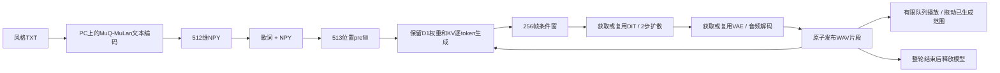

# 独立流式实验 App

`stream-app/`，包名 `com.zhilee.levostreamlab`，名称 **LeVo 流式实验 v0.1.15**。
与 `music-app/`、研究 App 和手机原有 LarkStudio App 独立；没有覆盖旧代码、包名或模型。
当前仅支持下面两个明确的模型契约，不是任意同名 Qwen 权重的通用播放器。

2026-11-18新增分组动态A8、仅音频＋EOS输出头及显式VAE图级融合开关。
融合模块实测快约16%，128位置新词表／EOS logits完全一致；App整链和长时成绩以已完成项目为准。
见[本次配方、对照与测速协议](STREAM_RUNTIME_OPTIMIZATIONS.md)。下文速度表保留原版本和条件。

120秒RTF约2.5主表及v0.1.10独立prefill／decode补测见[120秒性能与LLM补测](STREAM_120S_TIMING.md)。

v0.1.12新增短／长／自定义歌词选择。长样例含48行、318个歌词token，仍受原有511-token契约约束。
“生成到所选时长，忽略提前EOS”默认开启，可在空闲时切换；固定时长测速入口始终屏蔽EOS。
240／300秒测速自动使用长样例，停止按钮和内存门槛保持有效，不保证歌词逐字唱完或自然结束。

v0.1.13增加较大36层LLM／39层DiT模型的90／120秒实验入口；显式`longRun`上限为3000个code，
继续尊重bundle中存在的`runtime.maxFrames`，不改写权重清单或已有模型。当时较大模型使用原VAE，未开放图融合。

已完成0.6B长歌词240秒、冷却7分钟后较大模型120秒；实测总RTF分别4.025与9.088，
详见[长歌词实机报告](STREAM_LONG_DURATION_20261124.md)。两轮都保持前台并完成播放器验收。

v0.1.15把已验证的同一VAE融合路线开放给较大模型，默认开启；原始权重不变，保留`-VaeFusion 0`对照。
仅接受CPU Low／6线程和36处严格拓扑检查；新增15秒测速及可选首窗latent捕获，便于同输入对照。
较大模型新VAE的模块和短整链结果见[融合验收报告](LARGE_VAE_FUSION_20261124.md)。
同一HAP的15秒融合整链已完成，实测RTF5.751，72次融合调用；token、latent与原版两段WAV完全一致。
该轮额外等待解锁、起始温度较低，不能把其全部速度差归因于融合，也不替代原120秒RTF9.088。

## 两个模型契约

| 部分 | 0.6B 规格 | 4B 规格 |
|---|---|---|
| D1 | Qwen3，28层，H1024，FFN3072 | Qwen3，36层，H2560，FFN9728 |
| D1 实际参数 | 784,969,728，扩展词表且输入/头不共享 | 3,675,457,536，音乐词表16385 |
| D1 量化/运行 | 主体W4/g64、头W8、输入BF16；CPU High/4线程 | 同左 |
| 歌词/风格前缀 | start + 511个歌词位置 + 一行风格，513×1024 | 513×2560 |
| D1→DiT | 音频code查 `cond-token.f16[16384,1024]` | consume对齐的最后层hidden，经2560→2800→SiLU→1024投影 |
| DiT | 22层，H1200，FFN4800，30头；约394.013M | 39层，同宽；约688.160M |
| DiT 运行 | W8/g64，CPU High/6线程，2步Euler、CFG1.5；原7步/无CFG保留CLI对照 | W8/g64，CPU High/6线程，2步Euler，CFG1.5 |
| VAE | 共享84.414M Oobleck decoder，W8/g64、CPU Low/6线程、NEON正弦 | 同左 |

这些是用户已有独立模型包的规格和声明，**不是仓库历史上26层随机音乐适配原型**。
0.6B不需要4B的mu投影；`genre2start`是D1风格前缀投影，不能删除。
0.6B输入音频ID为151830+code，EOS为151765；4B输入为1+code，EOS为0。
不能相互套用offset、EOS、embedding或条件接口。

歌词将字面量`\\n`转换为换行，再加前导换行进行tokenize；不足511补ID0，超出时报错。
风格为512维little-endian float32 NPY，加artist表第一行256维，经768→H得到风格前缀。
新默认来自MuQ-MuLan文本分支；`clap-styles/`是沿用的文件夹名称，不能据此判断旧文件的编码器来源。
输入前缀统一舍入到BF16。0.6B测试的513×1024前缀与原App留存的输入逐元素一致，L2=0。
采样使用temperature=0.95、topK=250、seed=2307，无D1 CFG；随机数采样实现不保证与其他App逐token一致。

## 完整链路和内存



* 0.6B同一轮只有一套D1和KV，DiT/VAE首次使用时创建并保留，后续块不再加载、创建或resize；三网在首块后共驻，CPU串行执行，整轮结束统一释放。
* 4B继续按块分别创建/释放DiT与VAE；两种生命周期不可混称。没有跨请求隐藏会话池。
* 25Hz条件、64通道latent、48kHz双声道，1920样本/latent帧。
* window256帧/10.24秒，hop192帧/7.68秒，context64帧/2.56秒。
* 非末块先发布192帧，保留末64帧；下一块使用context latent并对64帧PCM交叉淡化。
* 末块截到真实长度；EOS可提前结束；总样本数严格为实际token数×1920。
* 每段写`.pending`，关闭成功后rename，随后才发布目录项。播放器只读已发布文件。
* 进度条上限是已发布时长，seek以20ms对齐；不能跳入尚未生成的内容。
* PCM播放器每次写20ms，最多预提交120ms，断粮会等待下一块；这是分块生成，不保证无间断实时播放。
* 停止是协作式取消，在token/算子会话/扩散步边界检查；不能强行抢断正在执行的MNN算子。
  保留已发布片段，不将部分输出标成整曲完成。
* 本实验UI限制1–60秒，默认10.2秒。进程RSS到6GiB、系统可用内存低于650MiB时在检查边界停止；实际60秒峰值2.514GiB。边界检查不是未来任意时长都不会OOM的保证。

## 构建、模型与签名

1. 在DevEco打开`stream-app/`，复制`build-profile.template.json5`为本地`build-profile.json5`，
   为独立包名生成调试签名。证书和本地配置均忽略，不上传。
2. `tools/build_stream_app.ps1`构建；首次创建未签名本地配置，已有签名保留。
   迁移电脑时用`-MnnRoot`／`-MnnLibrary`指定兼容静态库，可先用`-PrepareOnly`准备工程。
3. `tools/deploy_stream_app.ps1 -Device <hdc-target>`安装独立App，从用户手机原App的数据目录
   复制两个完整模型包，按各自manifest逐资产核验SHA256，再设置新App文件所有者。
   这是已连接调试设备上的迁移工具，不是普通App绕过沙箱读取其他App。
   新手机尚无原模型时用`-InstallOnly`仅安装App，权重另行迁移。完整步骤见[换手机安装指南](INSTALL_ON_ANOTHER_PHONE.md)。
4. `clap-styles/`只复制NPY，保留原模型默认风格。也可在新App内用文件选择器导入512维NPY。
   权重、NPY、歌词生成物和音频都不在Git中。

App默认走真实歌词/NPY和自回归采样。独立CLI无request参数时使用公式产生的固定测试code，
只验证数值/内存；**它们不是模型生成的音乐，也不是训练好的teacher序列**。
“播放链路自检”产生220Hz测试音，只验播放、seek、停止，不能用其RTF评价模型。

## 2026-11-12测量与限制

设备系统自报Mate 90 Pro Max，所有模型模块走CPU。下列为独立10.2秒单窗，非长文稳态或受控性能优劣对照：

| 输入/模型 | D1秒 | mu秒 | DiT秒 | VAE秒 | 全程秒/RTF | RSS峰值MiB |
|---|---:|---:|---:|---:|---:|---:|
| 真实歌词/风格，0.6B，CLI | 10.073 | 0 | 12.617 | 6.161 | 29.207 / 2.863 | 1322 |
| 真实歌词/风格，4B，App | 48.326 | 0.615 | 8.830 | 7.277 | 65.910 / 6.462 | 3044 |

D1列包含加载/prefill/decode；各列不能与其他轮次拼接宣称新的端到端结果。
0.6B WAV RMS约0.0624，峰值约0.3716，非静音且非反相抵消；**这不能证明音乐正常**。
用户后续已确认0.6B也正常出音乐。2026-11-13，用户对新MuQ文本默认风格、2步配置的60秒输出反馈“正常，有音乐”。这是主观试听确认，未进行客观音质、歌词对齐或风格匹配评测。

播放曾发现“拖到尾端只写4字节”错误，已改20ms对齐；页重建后播放器缺失的修复
会重建renderer并恢复已完成片段。AVPlayer首段试听用于区分生成内容与PCM播放问题。
硬件播放位置前进不等于用户已听见音乐。没有将其当成音质验收。

全部结构/完整性/数值/速度/用户试听结果分别记录到`reports/levo-test-report.json`。
旧数据、旧模型和旧实验保留；新的模型必须有独立modelId、明确codebook和条件契约。

## 当前提速结果

v0.1.6曾关闭0.6B的CFG混合公式，两个batch输入均为条件分支，直接取条件速度场。
v0.1.7按用户要求恢复CFG1.5：batch0不传风格/歌词mu条件，batch1传条件，按`uncond + 1.5*(cond-uncond)`更新。
底层图本来就是batch2，因此恢复CFG不再增加一套分支计算；无CFG与7步入口继续保留作显式CLI对照。
**当前图仍计算batch2**；不能宣称去掉CFG后DiT计算自动减半。

| App实测 | 时长 | D1秒 | DiT秒 | VAE秒 | 全程秒 | RTF | RSS峰值GiB |
|---|---:|---:|---:|---:|---:|---:|---:|
| 7步，按块加载，旧风格 | 60 | 86.021 | 139.696 | 69.514 | 297.665 | 4.961 | 1.968 |
| 2步，无CFG引导，共驻，完整头 | 15 | 14.684 | 8.491 | 11.313 | 34.834 | 2.322 | 2.157 |
| 2步，无CFG引导，共驻，裁剪头 | 15 | 11.128 | 7.506 | 11.106 | 30.072 | 2.005 | 2.007 |
| 同配置＋MuQ文本默认风格 | 60 | 51.550 | 29.611 | 42.509 | 124.577 | 2.076 | 2.514 |

各行来自实际整链，不拼接模块结果；风格、温度/调度状态并非全部受控，不将各行差值全部归因某一个改动。
15秒完整头与修正后的裁剪头：375个code及两份WAV的SHA256均完全一致。
60秒最后一行1500码、8段、KV2012位置，首段17.671秒，最低系统余量3012MiB。
可边生成边播放，但RTF仍高于1，播放追上生成时会等待；没有承诺连续无停顿实时生成。

2026-11-13 v0.1.7恢复CFG后，实际375码/15秒/两窗：D1 11.139秒，DiT 7.420秒，
VAE 10.837秒，总29.721秒/RTF1.981，首段17.840秒，采样RSS2061.14MiB。
播放器硬件位置到15000ms，未报告播放错误。它是独立短生成验证，不是新的60秒成绩或主观听感验收；
也不能将不同轮次的速度差异归因于CFG。

### 音乐输出头裁剪

完整头168214类中，原采样只使用音频151830..168213和EOS151765。
独立裁剪保留连续151765..168213，共16449行（含64个不参加采样的间隔类），
输出EOS=0，音频输出起点=65；**输入音频ID仍为151830+code**。
只复制原W8编码行和对应量化参数，不重新量化。权重412,069,026→251,805,186字节，
完整BF16输入表344,502,272字节保留。D1参数口径约784.970M→629.562M。
原包保留，因此手机总存储会增加一个独立实验版本，而非删除原包后的净节省。

入口：`native-bench/StreamLabHeadCrop.cpp`；对照：`StreamLabPrefillProbe.cpp`。
这些工具仅接受检查过的本包W8布局，不应当作任意MNN模型的通用裁剪器。
App使用`files/experimental/music-head-r1/`独立模块，找不到时使用完整头。
该目录必须含真实的graph、weight、llm_config、tokenizer和完整embedding文件。
手机沙箱内的embedding符号链接曾导致第2个token开始分歧；改为实文件后375码/两段PCM恢复完全一致。
独立CLI通过不能替代App内验证。

### 未启用的路线

当前VAE的裁剪、真实尾窗与热点验证见[窗口实验](STREAM_VAE_WINDOWS.md)。
16帧VAE边界上下文已在两份输入的指定区域通过零误差比较，尚未替换App的64帧DiT重叠及PCM衔接。
当前DiT布局、GELU融合及CANN FFN子图结果见[ONNX布局研究](DIT_ONNX_LAYOUT.md)；App尚未改为NPU DiT。

* 单分支图：修正3个输入与6个确认的batch形状常量后可运行、模块约快2倍，但速度场相对双条件分支L2约11.6%–12.6%，未通过1e-5校验，**未部署**。
* LLM/DiT/VAE线程3/4/6：15秒CLI30.984秒，未优于4/6/6候选30.629秒；保持4/6/6。
* LLM预取下一窗与当前DiT/VAE并行：3/4/4下15秒31.389秒，发生CPU资源竞争，未提速；保持关闭。重叠计时的阶段和可能大于墙钟时间。
* 保留原7步与hidden条件等CLI研究入口，当前App固定2步、token查表；未静默切换这些接口。

## MuQ-MuLan文本风格

[官方仓库](https://github.com/tencent-ailab/MuQ)提供文本音乐联合编码接口；
[固定模型配置](https://huggingface.co/OpenMuQ/MuQ-MuLan-large/blob/2e01c796b71dca71b45251384c04cd7b237c9020/config.json)的输出维度为512。
采用官方文本模块＋训练好的投影、FP32 CPU推理，L2归一化。输入为`configs/styles/warm-pop.txt`。
结果为`models/styles/muq-text-warm-pop.npy`，SHA256：
`83229638309691901de48cecebc5185bc9424b5ca7256508a708cc544954e968`。

当前PC只提取所需文本权重，跳过音频分支；保存完整文本模块参数，并只保留本描述用到的原始词embedding行、重映射输入ID。
所有推理参数严格加载训练权重，没有以随机参数补缺；新描述必须重新prepare相应词行，未知ID报错。
这是数据传输/词表优化，未量化MuQ。完整下载的存储块核验原ZIP CRC，整份joint模型SHA未重算；报告明确区分。

```powershell
# 官方source固定到28847ea50cd31ac4b8b6a7dacc051ad7d1c7606a，位于reference/MuQ
# Python依赖：torch、transformers、numpy、requests、safetensors、sentencepiece、x-clip、ftfy、wcwidth、beartype、einops
python tools/prepare_muq_text_checkpoint.py --text-file configs/styles/warm-pop.txt
python tools/extract_muq_text_style.py --text-file configs/styles/warm-pop.txt --checkpoint models/muq-text-only --out models/styles/muq-text-warm-pop.npy
```

也支持完整官方checkpoint的SHA256校验路径。NPY导出拒绝覆盖旧文件，伴随TXT/JSON来源记录。
手机只导入NPY，不加载MuQ模型；0.6B首次打开默认选择“MuQ文本·温暖流行”，4B旧默认保留。
60秒结果确认实际读取新NPY，风格前缀发生改变，原歌词/start前512行保持一致。
51项CPU测试通过；原模型、NPY、音频、签名及本机依赖不上传Git。
