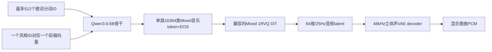

# 单路混合歌曲学生模型 v0.1

这是新的研究架构，不是官方LeVo的0.6B检查点。

## LM与长度

- Qwen3官方配置：28层、hidden=1024、FFN=3072、16个Q头、8个KV头、head_dim=128。
- 新增音乐embedding、音乐输出头和32种风格embedding；因此完整学生略大于0.6B，运行`check_architecture.py`得到精确数量。没有隐瞒新增参数。
- 512是歌词分词上限，不是字符数，也不是音频token长度。一个风格token在歌词前，音频BOS在歌词后；实际prefill最多514位置。
- 风格ID是受训类别。自由文字风格不可能未经训练自动压成一个有音乐语义的token。
- 一秒目标音频对应25个音乐帧。30秒750帧；3分钟4500帧；5分钟7500帧。最大输出独立设置。
- 对每首歌曲prefill一次，逐音乐token解码并保存KV；下一首重置KV。当前参考decode采用greedy，尚未做音质调参。
- 不含第二个Track-Specific LM，不生成独立人声/伴奏token。Mixed token本身包含二者。

## DiT和VAE

优先复用官方`Flow1dVAE1rvq`混合codec，而不是把Dual-Track的两路ID随意相加。先核对codebook顺序、VQ embedding、采样调度、条件输入、latent归一化、mask和tail prompt，随后才可导出MNN图。

官方VAE路线为48kHz双声道、64维latent、25Hz，压缩率1920，stride为2/4/4/6/10。这和CosyVoice的Mel/HiFT不是同一接口。生成只需要decoder；不使用参考音频时无需常驻完整音频encoder。

已读取Runtime官方VAE配置：Oobleck encoder/decoder，base channels128，channel multipliers=[1,2,4,8,16]，使用Snake激活；encoder输出128通道用于VAE瓶颈，decoder输入64通道，输出2声道，final_tanh=false。decoder按逆序上采样10/6/4/4/2。不是HiFiGAN，也不能复用CosyVoice HiFT权重。

已读Mixed codec真实safetensors头而非下载全部权重：其DiT为39层、宽度1200，QKV合并矩阵[1200,3600]、FFN中间维4800。这是Mixed路线，不能套用Dual-Track的16层/2200维配置。精确权重头统计见统一测试报告。

检查的公开源码快照`653cbcf4716101834900c75b7d5da43b07e15d5b`中，`model_1rvq.py`的`cfm_wrapper`构造被注释，但推理仍调用它。适配器显式拒绝这种未构造完整DiT的实例；尚未修复并完成端到端权重验证。

`codec.py`只定义待导出的接口及形状检查；它的显式Euler调用合同尚未与官方实际采样器对应验证，不能将官方权重直接塞进该接口后宣称可用。必须编写官方codec导出适配器，并对同种子latent/波形做一致性测试。

## 内存与鸿蒙

首轮只走MNN CPU，模型/音乐ID/codec版本分别校验。LM生成token后可释放LM与KV，再分块运行DiT/VAE。后续再研究共驻和句内流水，不先承诺实时。

28层/8KV头/128维/FP16 KV：每位置114688字节。30秒加最大歌词前缀约138MiB，3分钟约548MiB，5分钟约876MiB；尚未加CFG多分支、激活和权重packing。

鸿蒙应用当前只构建架构展示与只读内存诊断，尚未链接MNN音乐运行时。独立包名`com.zhilee.levoharmony`；不覆盖CosyVoice。

## 验收分级

1. 微型随机模型：前向/反向、KV增量解码与全序列一致性、长度/codec拒绝路径。
2. 完整0.6B meta模型：精确参数计数，无真实权重加载声明。
3. 公共Qwen真实权重加载：只证明文本骨干兼容，不证明音乐能力。
4. 用合法音频/教师Mixed token训练；相同codec下评估词错、旋律、连续性。
5. 真DiT/VAE导出后PC对齐，再运行手机30秒，统一导出RTF/RSS/首块延迟。
